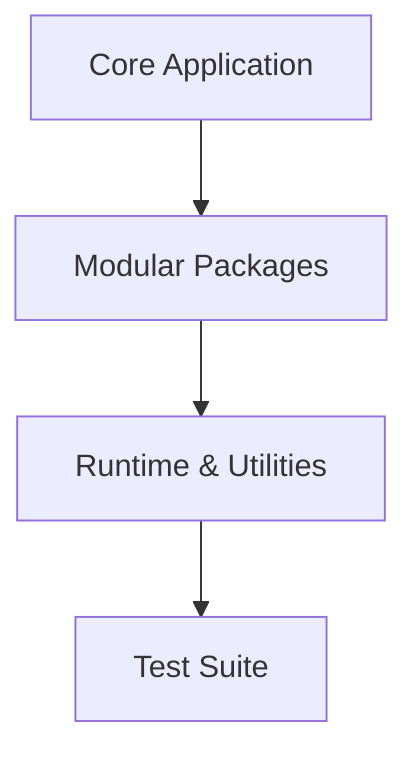

# 🏛️ Executive Codebase Audit & Architecture Report

> **Target Project:** `lunariz`  
> **Absolute Path:** `C:\lunariz`  
> **Audit Timestamp:** `2026-10-27 00:21:39`  
> **Auditor Version:** `Project-Auditor v1.0 Enterprise`

---

## 1. Executive Scorecard: **85.5 / 100.0** (Grade: **A**)

| Category | Score | Max | Status |
| :--- | :---: | :---: | :--- |
| **System Architecture & Modularity** | **22.5** | 25.0 | 🟢 Optimal |
| **Code Cleanliness & Maintainability** | **13.0** | 25.0 | 🟡 Complexity Hotspots |
| **Security Hygiene & Secret Scanning** | **25.0** | 25.0 | 🟢 Secure |
| **Production Readiness & Testing** | **25.0** | 25.0 | 🟢 Ready |

---

## 2. Tech Stack & Quantitative Inventory

- **Total Files Scanned:** `33`
- **Total Lines of Code (SLOC):** `3,409` (Total raw lines: `4,231`)
- **Comments Ratio:** `5.7%`
- **Detected Frameworks & Libraries:** `Standard Library / Vanilla`
- **Dependency Manifests:** `pyproject.toml`

### Language Breakdown
| Language | Files | Code Lines | Comments |
| :--- | :---: | :---: | :---: |
| **Python** | 24 | 3221 | 161 |
| **Other** | 7 | 115 | 16 |
| **Markdown** | 1 | 54 | 16 |
| **TOML** | 1 | 19 | 0 |

---

## 3. High-Level Architectural Flow

---

## 4. The 360° Tech-Company Multi-Persona Review

### 👔 1. Product Manager Verdict
* **Feature Completeness:** High structural organization with clear entry points.
* **Repository Health:** README: `✓ Present` | LICENSE: `✓ Present` | CI/CD: `✓ Configured`.

### 🏗️ 2. System Architect Verdict
* **Modularity:** Detected 1 oversized 'God Files' (>450 LOC).
* **Structural Coupling:** Component separation follows clean modular layers. Ensure core business logic does not depend on UI presentation layers.

### 💻 3. Senior Tech Lead Verdict
* **Complexity Hotspots:** Found `8` functions with high cyclomatic complexity or length:
| File | Function | Line | Complexity | Recommendation |
| :--- | :--- | :---: | :---: | :--- |
| `lunariz\cli.py` | `cmd_tasks` | Line 272 | Complexity: **12** | High Complexity |
| `lunariz\core\indexer.py` | `sync_from_storage` | Line 112 | Complexity: **9** | Long Function |
| `lunariz\core\indexer.py` | `search` | Line 177 | Complexity: **8** | Long Function |
| `lunariz\core\search.py` | `score_note` | Line 13 | Complexity: **11** | High Complexity |
| `lunariz\core\storage.py` | `parse_frontmatter` | Line 101 | Complexity: **11** | High Complexity |

### 🛡️ 4. Security & QA Officer Verdict
* **Vulnerability Scan:** Found `0` potential security smells or dangerous calls:
| Severity | Location | Issue Description |
| :---: | :--- | :--- |
| **NONE** | Clean | No critical security smells detected |
* **Testing Posture:** Test suite: `✓ Configured & Present`.

---

## 5. Prioritized Action Plan

1. **Immediate (High Priority):**
   - Address any `CRITICAL` or `HIGH` security findings listed in Section 4.
   - Refactor functions with Cyclomatic Complexity $> 12$ into single-responsibility sub-routines.
2. **Medium Priority:**
   - Maintain and update documentation.
   - Maintain CI/CD matrix across all target platforms.
3. **Long-Term Polish:**
   - Keep God Files below 400 LOC for long-term maintainability.
